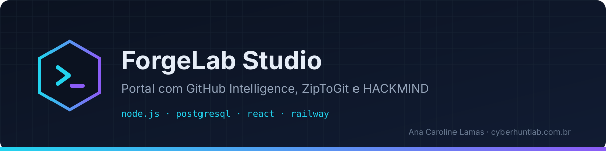

<p align="center"></p>

# ForgeLab Studio — portal SaaS com GitHub Intelligence, ZipToGit e HACKMIND

Portal em **Node.js** com **PostgreSQL** que reúne três ferramentas num único produto, com autenticação, planos e painel administrativo. Ele foi preparado para deploy no **Railway**.

| Módulo | Pasta | Função |
|---|---|---|
| **GitHub Intelligence** | `modules/github-intelligence/` | Análise de repositórios e de perfil profissional no GitHub, com verificação de segurança (React/Vite + Express, monorepo pnpm) |
| **ZipToGit** | `modules/ziptogit/` | Inspeção de ZIP/APK com defesas contra Zip Slip e zip bomb, análise de arquitetura clean-room e publicação no GitHub |
| **HACKMIND** | `modules/hackmind/` | Pesquisa de editais, análise de projetos vencedores e geração de ideias e planos para hackathons |

## Recursos do portal

- **Páginas públicas**: `/` e `/apresentacao` (apresentação), `/venda` (oferta), `/login` (usuários) e `/painel` (área do usuário).
- **Administração** em `/admin`, protegida por sessão assinada e sem link no menu público:
  - gestão de usuários (plano gratuito, Premium mensal ou vitalício; ativo ou suspenso);
  - preço único ativo e URL de checkout externo;
  - parâmetros JWT (`iss`, `aud`, validade);
  - Google Analytics 4, Tag Manager, Search Console e SEO.
- **Autenticação JWT** em cookie, com renovação (`/api/auth/*`). Os módulos exigem plano `monthly` ou `lifetime`.
- **Webhook de pagamento** (`POST /api/webhooks/payment`) com assinatura HMAC-SHA256 no cabeçalho `X-ForgeLab-Signature`; ativa e cancela planos conforme o evento.
- **Persistência em PostgreSQL** (driver `pg`): as tabelas `app_users` e `app_settings` são criadas na primeira inicialização, com senhas em hash.
- **Diagnóstico** em `/api/health`.

## Instalação

Requisitos: **Node.js 20+** e um **PostgreSQL**.

```bash
git clone https://github.com/ticarollamas-arch/Cyberhuntlab-Dev.git
cd Cyberhuntlab-Dev
npm install
cp .env.example .env
```

| Variável | Uso |
|---|---|
| `DATABASE_URL` / `DATABASE_SSL` | Conexão PostgreSQL (obrigatória) |
| `ADMIN_EMAIL`, `ADMIN_PASSWORD`, `ADMIN_SESSION_SECRET` | Acesso administrativo |
| `JWT_SECRET`, `APP_ENCRYPTION_KEY` | Assinatura de tokens e cifra de dados (use `openssl rand -hex 32`) |
| `GITHUB_TOKEN` | Integrações com o GitHub |
| `GROQ_API_KEY`, `NVIDIA_NIM_API_KEY`, `OLLAMA_*`, `CUSTOM_AI_*`, `AI_DEFAULT_PROVIDER`, `AI_DEFAULT_MODEL` | Provedores de IA dos módulos |

## Como usar

```bash
npm start        # http://localhost:4173
npm run dev      # com recarregamento automático
```

O portal local serve a apresentação, o login e o painel. Cada módulo tem README e `.env.example` próprios e é compilado como um serviço separado.

### Deploy no Railway

1. Crie o projeto a partir deste repositório e adicione um serviço **PostgreSQL**.
2. Defina `DATABASE_URL` com a referência do banco (ex.: `${{Postgres.DATABASE_URL}}`) e as demais variáveis.
3. O comando de inicialização é `npm start`; o Railway fornece `PORT`.

## Avisos

- Valide autenticação, webhook e integrações em produção antes de abrir vendas, e publique termos, política de reembolso e consentimento de Analytics.
- O webhook usa um ciclo mensal aproximado de 31 dias; ajuste-o ao gateway real.
- Nunca exponha segredos em variáveis `VITE_*` ou no navegador.
- A análise de ZIP/APK deve ser feita apenas em material próprio ou autorizado.
- O currículo, quando usado, é só contexto privado para comparar competências com evidências dos repositórios; nada é inventado ou publicado.

## Tecnologias

Node.js · PostgreSQL (`pg`) · JWT · HMAC-SHA256 · React · Vite · Express · TypeScript · pnpm · Groq · NVIDIA NIM · Ollama · Railway

## Licença

Este repositório ainda **não tem licença definida**. Os três módulos vêm de bases de código independentes; veja [docs/LICENCAS-E-DIREITOS.md](docs/LICENCAS-E-DIREITOS.md) antes de redistribuir. Dependências de terceiros mantêm suas próprias licenças.
